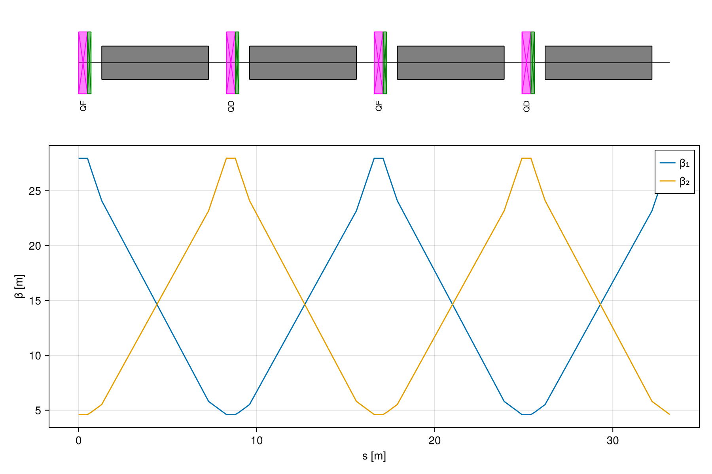
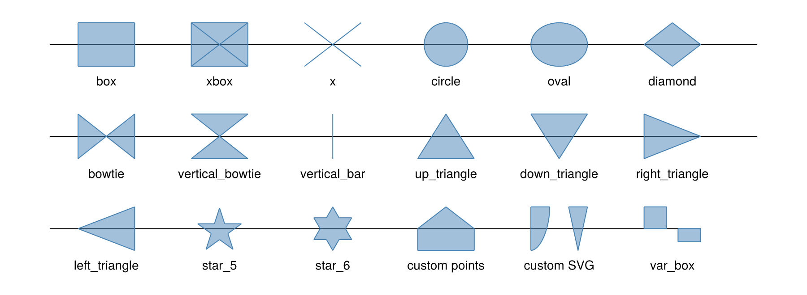

# SciBmadUtils.jl

[](https://github.com/bmad-sim/SciBmadUtils.jl/actions/workflows/CI.yml)

Simulation utilities for the [SciBmad](https://github.com/bmad-sim/SciBmad.jl) ecosystem.

This package holds:
- The translator from SciBmad lattices, built with
  [Beamlines.jl](https://github.com/bmad-sim/Beamlines.jl), to the
  [PALS](https://github.com/pals-project/pals) (Particle Accelerator Lattice Standard) format.
  See [SciBmad to PALS translation](#scibmad-to-pals-translation).
- Lattice layout plots drawn with Makie. See [Lattice layout plots](#lattice-layout-plots).

## Installation

```julia
import Pkg
Pkg.add(url="https://github.com/bmad-sim/SciBmadUtils.jl")
```

## SciBmad to PALS translation

Two functions are exported:

- `to_pals(x)` returns the PALS tree as a nested dictionary (`OrderedDict`). Use it to inspect
  or modify the result before writing it.
- `write_pals(filename, x)` writes the PALS tree to a YAML file. By convention, PALS files
  have the extension `.pals.yaml`. Strings are written without quotation marks where that is
  unambiguous. BeamLine `line`s and other lists of names use the concise form `[a, b, c]`.

`x` can be a `Lattice`, a `Branch` or a `Beamline`.

```julia
using Beamlines, SciBmadUtils

qf = Quadrupole(name="qf", L=0.5, Kn1=0.36)
d  = Drift(name="d", L=1.0)
qd = Quadrupole(name="qd", L=0.5, Kn1=-0.36)
b  = SBend(name="b", L=2.0, g_ref=0.01, Kn0=0.01)

fodo = Beamline([qf, d, b, d, qd, d, b, d], species_ref=Species("electron"), E_ref=18e9)
lattice = Lattice([fodo], name="fodo_lattice")

write_pals("fodo.pals.yaml", lattice)
```

This writes:

```yaml
PALS:
  version: null
  facility:
    - b1_begin:
        kind: BeginningEle
        ReferenceP:
          species_ref: electron
          E_tot_ref: 1.8e10
    - qf:
        kind: Quadrupole
        length: 0.5
        MagneticMultipoleP:
          Kn1: 0.36
    - d:
        kind: Drift
        length: 1.0
    - b:
        kind: Bend
        length: 2.0
        BendP:
          g_ref: 0.01
        MagneticMultipoleP:
          Kn0: 0.01
    - qd:
        kind: Quadrupole
        length: 0.5
        MagneticMultipoleP:
          Kn1: -0.36
    - b1:
        kind: BeamLine
        line: [b1_begin, qf, d, b, d, qd, d, b, d]
    - fodo_lattice:
        kind: Lattice
        branches: [b1]
```

For a `Branch` or `Beamline`, the lattice name can be set with the `lattice_name` keyword
argument. For a `Beamline`, the branch name can also be set with the `name` keyword argument.

### Lattice structure

- Each element is defined once at the start of the `facility`, then each branch becomes a
  PALS `BeamLine`, and the `Lattice` comes last.
- Each branch `BeamLine` starts with a `BeginningEle` element named `<branch>_begin`. It holds
  the reference species and energy of the first `Beamline` of the branch in a `ReferenceP`
  group.
- If a later `Beamline` in a branch sets the reference species or energy, a `ReferenceChange`
  element named `<branch>_ref_change` is put at its start.
- A reference energy given as a magnetic rigidity (`p_over_q_ref`, `dp_over_q_ref`) is written
  as the reference momentum `pc_ref` computed by Beamlines. PALS has no rigidity parameter.
- Unnamed branches are named `b<N>`. A lone `Branch` or `Beamline` defaults to `branch` or
  `beamline`. An unnamed lattice is named `lattice`.

### Element names

- PALS names may contain only letters, digits and underscores and must not start with a
  digit. Other characters are replaced by `_`, so `q.1` becomes `q_1`.
- Unnamed elements get a name from their PALS kind, e.g. `drift`, `drift_1`. Copies of the
  same unnamed element share one name.
- Names must be unique in a PALS file. Where a generated name clashes, `_<N>` is appended.
- Several elements can share a name but have different parameters. The first one is the
  definition. Each later one appears in the `line` with only the parameters that differ.
  Parameters it does not have are set to `null` (unset). For example:

  ```yaml
  line: [d, {d: {length: 2}}]
  ```

### Element kinds

SciBmad kinds become PALS kinds as follows. Any other kind is written unchanged.

| SciBmad              | PALS                                  |
|----------------------|---------------------------------------|
| `SBend`              | `Bend`                                |
| `HKicker`, `VKicker` | `Kicker`                              |
| `BPM`                | `Instrument`                          |
| `CrabCavity`, or `RFParams` with `is_crabcavity` | `CrabCavity` |
| no kind              | `Drift` if the length is nonzero, otherwise `Marker` |

### Parameter groups

| SciBmad                | PALS                        | Notes |
|------------------------|-----------------------------|-------|
| `UniversalParams`      | `kind`, `length`, `TrackingP` | A non-default `tracking_method` goes in `TrackingP: SciBmad:` |
| `MetaParams`           | `MetaP`                     | |
| `AlignmentParams`      | `BodyShiftP`                | `tilt` → `z_rot` |
| `ApertureParams`       | `ApertureP`                 | `x1_limit`, `x2_limit`, `y1_limit`, `y2_limit` → `x_min`, `x_max`, `y_min`, `y_max`. Infinite limits are left out. `aperture_shifts_with_body` is written when `true` since the PALS default is `false`. |
| `BendParams`           | `BendP`                     | If `g_ref` is set but no dipole field (`Kn0`, `Bn0`, `Kn0L`, `Bn0L`), then `Kn0_from_g_ref: false` is written. A SciBmad bend has no field unless one is set. |
| `BMultipoleParams`     | `MagneticMultipoleP`        | Same parameter names (`Kn1`, `Bs2L`, `tilt3`, ...) |
| `EMultipoleParams`     | `ElectricMultipoleP`        | `etiltN` → `tiltN` |
| `RFParams`             | `RFP`                       | `rf_frequency` → `frequency`, `phi0` → `phase` (radians in both), `traveling_wave` → `cavity_type: TRAVELING_WAVE` |
| `PatchParams`          | `PatchP`                    | `dx`, `dy`, `dz`, `dx_rot`, `dy_rot`, `dz_rot` → `x_offset`, `y_offset`, `z_offset`, `x_rot`, `y_rot`, `z_rot`. `user_sets_length: true` is always written since a SciBmad patch length is set by the user. |
| `InitialBeamlineParams` | `ReferenceP` / `ReferenceChangeP` | See [Lattice structure](#lattice-structure) |
| `IgnoreParams`         | `aperture_active`, `SciBmad_ignore_params` | An ignored `ApertureParams` sets `ApertureP.aperture_active: false`. Other ignored groups are listed by their PALS name. |
| `BeamlineParams`       | —                           | Not written. It only records where an element sits in a `Beamline`. |

Parameters with default values are not written.

### SciBmad extensions

Some SciBmad parameters have no PALS equivalent. They are written as
[PALS extensions](https://pals-project.readthedocs.io/en/latest/extensions.html) whose names
start with `SciBmad_`. When any are present, the file declares the prefix in
`extension_labels`. The extensions are:

- `PatchP.SciBmad_dt`: the `dt` time offset of a patch.
- `SciBmad_ignore_params`: the ignored parameter groups (see above).
- `SciBmad_MapParams`, `SciBmad_FourPotentialParams`, `SciBmad_EMFieldParams`: these groups
  hold Julia functions, so only their string representation is written. A lattice with
  these groups cannot be fully reconstructed from the PALS file.

### Deferred expressions

`DefExpr`s are evaluated, using the `Context` of the lattice, when the translation is done.
The PALS file therefore holds numbers, not expressions. Values must be real numbers: for
lattices with GTPSA or automatic differentiation types, use `scalarize` first.

## Lattice layout plots

A lattice layout shows the placement of the elements of a `Beamline`, `Branch` or `Lattice` 
as a function of `s`, and is typically drawn above or below a plot of, e.g., the Twiss 
functions. This is modeled after the Tao `lat_layout` plot. Plotting uses Makie, so a Makie 
backend (e.g. CairoMakie or GLMakie) must be loaded. Makie is not a hard dependency of SciBmadUtils:
the drawing functions become available when Makie is loaded.

```julia
using SciBmad, SciBmadUtils, CairoMakie

# Two FODO cells with sextupoles next to the quadrupoles
@elements begin
  QF = Quadrupole(L = 0.5, Kn1 = 0.36)
  QD = Quadrupole(L = 0.5, Kn1 = -0.36)
  SF = Sextupole(L = 0.2, Kn2 = 1.0)
  SD = Sextupole(L = 0.2, Kn2 = -1.0)
  B  = SBend(L = 6.0, angle = π/132)
  D1 = Drift(L = 0.6)
  D2 = Drift(L = 1.0)
end
cell = [QF, SF, D1, B, D2, QD, SD, D1, B, D2]
bl = Beamline([cell; cell], species_ref = Species("electron"), E_ref = 18e9)

tw  = twiss(bl)
fig = Figure(size = (900, 600))
ax  = Axis(fig[2, 1], xlabel = "s [m]", ylabel = "β [m]")
lines!(ax, tw.s, tw.beta1, label = "β₁")
lines!(ax, tw.s, tw.beta2, label = "β₂")
axislegend(ax, position = :rt)
lat_layout(fig[1, 1], bl; link = ax, height = 150)   # Layout above the plot. Use fig[3, 1] for below.
fig
```



- `lat_layout(gridpos, line; link, ...)` creates a new axis; `lat_layout!(ax, line; ...)` draws into an existing one.
- Available shapes: `:box`, `:xbox`, `:x`, `:circle`, `:oval`, `:diamond`, `:bowtie`, 
  `:vertical_bowtie`, `:vertical_bar`, `:up_triangle`, `:down_triangle`, `:right_triangle`, 
  `:left_triangle`, `:star_5`, `:star_6`, `:var_box`, or a custom shape given as a vector of 
  points or an SVG path string. Each shape has a `fill_color` and `line_color`. See `LayoutShape`.
- A `:var_box` has one edge on the center line and the other at `size * p`, where `p` is an element 
  parameter given by `height_param`, e.g. 
  `LayoutShape(shape = :var_box, height_param = :Kn1, size = 0.5)`. It is above the center line 
  for `p > 0` and below for `p < 0`.

  

- Zero-length elements are drawn as wide as they are tall.
- The shape, color, and size used for each element `kind` are in `DEFAULT_LAYOUT_SHAPES`. 
  Override them per kind or per element name with `shapes = Dict("Quadrupole" => LayoutShape(color = :red))`.
- `polarity = true` draws focusing quadrupoles above the center line and defocusing ones below.
- `lat_layout_shapes(line)` returns what would be drawn, without drawing it.

Note: Beamlines and Makie both export `LineElement`. If both are loaded with `using`, 
refer to the lattice element type as `Beamlines.LineElement`.
